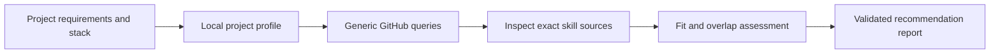

# Skill Radar

### Project-aware Agent Skill Discovery & Evidence-backed Recommendations

**Find the right AI skills for what you are building.** Skill Radar reads your project's requirements, stack, and existing skills, searches GitHub, and turns verified candidates into a short, explained recommendation report.

[中文介绍](README.zh-CN.md) · [Quick start](#quick-start) · [Workflow & data formats](references/workflow.md) · [Scoring rubric](references/rubric.md)

  

> Your project is the starting point. GitHub stars are one signal. Every recommendation needs a reason, a source, and a clear account of what remains untested.

## Why Skill Radar?

Finding a popular skill is easy. Knowing whether it fits your framework, fills a real gap, and adds something beyond your installed skills takes more work.

Skill Radar gives your coding agent a repeatable workflow for that decision. It recommends up to three skills per project by default, can recommend none, and explains why a candidate should be tried, deferred, reused, or skipped.

## What it does

| Capability | What you get |
| --- | --- |
| Understand project context | A bounded scan of requirements, root documentation, dependency manifests, and source filenames. The host agent distinguishes current capabilities from planned work. |
| Evaluate multiple projects | Separate recommendations for each project, with shared engines and duplicate checkouts identified by the host agent. |
| Search GitHub for relevant skills | Generic task and technology queries, repository discovery, and inspection of skill collections. Connected GitHub tools are preferred; a REST CLI is included as a fallback. |
| Verify the actual skill | An exact `SKILL.md` path, commit-pinned source URL, content hash, inspection time, and repository metadata. A framework or SDK alone is not treated as a skill. |
| Account for existing coverage | Compare candidates with installed skills and explain incremental value. Reusing an existing skill is a valid outcome. |
| Explain the ranking | Project fit, compatibility, incremental value, maintenance, and popularity, with a reason for each score. |
| Validate report evidence | Reject nonexistent project evidence paths, quotes absent from fetched text, inconsistent source hashes, and recommendations that violate compatibility or verification checks. |
| Deliver usable reports | Markdown, standalone local HTML, and ranked JSON. The HTML requires no server or external scripts. |



## Quick start

Clone this repository:

```bash
git clone https://github.com/li3jia4hao5-hue/skill-radar.git
```

Give its local path to your coding agent:

```text
Read <path-to-skill-radar>/SKILL.md and use Skill Radar to find skills
for my project at <path-to-project>.
Check existing skills, verify GitHub sources, and explain the top matches.
```

For persistent installation, copy the full repository folder as `skill-radar` into your client's supported skills directory. Check for an existing installation before replacing it. This repository uses the `SKILL.md` format; installation locations, tool permissions, and invocation support depend on the host client. The workflow has been exercised in Codex; other clients need their own verification.

**Requirements:** a host agent that can read local files and search/read GitHub; Python 3.10+ for the helper CLI. The Python scripts use only the standard library and do not require a separate model API key. The host agent and any connected services retain their own requirements and costs.

### Example requests

```text
Use Skill Radar to find testing and accessibility skills for this web app.

Review these three projects. Recommend at most two new skills per project
and tell me where my existing skills already cover the work.

I am planning a Python document-processing service. Find relevant skills
from the requirements below and mark assumptions that need verification.
```

If there is no code yet, the agent can use a requirements-only profile and return an inline assessment. The file-based report validator expects real project file evidence.

## What a recommendation looks like

The following is an **illustrative format**, not a live GitHub result or measured outcome:

| Project need | Outcome | Explanation |
| --- | --- | --- |
| Tests for a Python API | Try a verified testing skill | Covers an identified testing gap; list supported tools and the pinned source. |
| Browser-based UI checks | Conditional | Relevant workflow, but browser permissions still need checking. |
| Video rendering | Reuse installed skill | Existing instructions already cover the task. |
| Skill for a different framework | Skip | Popularity does not resolve framework incompatibility. |

A real report also records project evidence, a short source excerpt, candidate constraints, overlap, scoring reasons, search coverage, and unresolved checks.

## How ranking works

Each dimension is scored from 0 to 5 by the host agent. The script computes a weighted score out of 100:

| Dimension | Weight |
| --- | ---: |
| Project fit | 40% |
| Compatibility | 25% |
| Incremental value | 15% |
| Maintenance | 10% |
| Popularity | 10% |

Scores are **explainable heuristics**, not calibrated probabilities or proof of productivity gains. A high score cannot override failed verification, known incompatibility, an archived repository, or existing coverage when making a new recommendation. See the [full rubric](references/rubric.md).

## Helper CLI

The agent handles project understanding, search planning, and semantic assessment. The CLI handles bounded collection and validation; it does not call an LLM or autonomously decide what fits.

```bash
python scripts/radar.py --help
python scripts/radar.py scan --config config.json --out work/profile.json
python scripts/radar.py search --plan search-plan.json --out work/discovery.json
python scripts/radar.py inspect --repo owner/repo --path skills/example/SKILL.md --out work/candidate.json
python scripts/radar.py report --profile work/profile.json --candidates work/candidates.json --assessment work/assessment.json --out work/report
```

`owner/repo` and the skill path above are placeholders. Configuration and assessment schemas are documented in [workflow.md](references/workflow.md). A small [synthetic project and scan config](examples/README.md) let you try the local scanner without sharing a real project.

## Data handling and trust

- Scan output stays local. The workflow sends generic search terms to GitHub, not project documents, customer names, or absolute paths.
- The scanner uses bounded document and path allowlists; it does not execute project code or candidate skills. It skips environment files, common data directories, and linked paths.
- Root documentation can still contain private information. Redaction is best effort, and raw profiles and real reports must not be assumed safe to publish.
- Candidate instructions are untrusted material to inspect. Source verification establishes provenance and consistency; it is not a security audit or an execution test.
- GitHub search is incomplete and may be rate-limited. Reports must disclose coverage and failures. Stars belong to the repository, not necessarily an individual skill in a collection.

## Status and roadmap

**v0.1: initial project matching is implemented.** This is an early release, and recommendations still need a real task trial before their benefit can be claimed.

| Stage | Scope | Status |
| --- | --- | --- |
| 1 | Project scan, discovery, source checks, explainable recommendations, local reports | Available |
| 2 | Weekly discovery, saved snapshots, newly published skills and star-growth comparisons | Planned |
| 3 | Reassess skills when project requirements or dependencies change | Planned |
| 4 | Incorporate adoption feedback and measured task outcomes | Planned |

No background scheduler, change watcher, persistent feedback learning, or automatic candidate installation is included in v0.1. You can manually rerun the initial workflow after your project changes.

## Development and contributions

```bash
python -m unittest discover -s tests -v
```

Tests use temporary projects and mocked GitHub responses. They cover scan boundaries, pinned inspection, evidence validation, failure reporting, and HTML escaping. They do not establish live API availability or recommendation quality. A symlink test may skip when the operating system denies link creation.

Useful contributions include anonymized fit/mismatch cases, additional manifest support, host-client compatibility checks, and clearer scoring criteria. See [CONTRIBUTING.md](CONTRIBUTING.md). Please remove private paths, business text, and credentials before submitting examples.

If this workflow helps, star the repository or share a reproducible case through [Issues](https://github.com/li3jia4hao5-hue/skill-radar/issues).

## License

[MIT](LICENSE). Third-party candidate skills are not bundled; each retains its own license and requirements.
